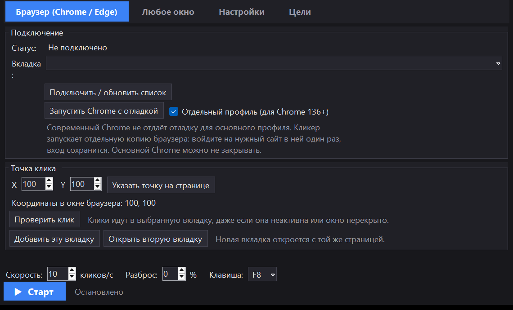

# BgClicker

<p align="center">
  
</p>

Фоновый автокликер для Windows, который кликает в одну точку **не трогая мышь и не забирая фокус**.
Курсор не прыгает, активное окно не меняется — можно спокойно работать в других программах.



## Возможности

- **Браузер (Chrome / Edge)** — клики отправляются прямо в выбранную вкладку через
  отладочный протокол Chrome (CDP). Работает, даже если вкладка неактивна, а окно браузера
  перекрыто другими окнами.
- **Любое окно** — клик отправляется сообщениями Windows (`WM_LBUTTONDOWN`/`WM_LBUTTONUP`)
  в выбранное окно по фиксированным координатам. Подходит для обычных программ.
- **Несколько целей** — можно добавить несколько вкладок браузера и/или окон: кликер
  кликает по всем за один цикл.
- Скорость от 1 до 1000 кликов/с (в браузере — до 200), «разброс» интервала в процентах.
- **Автообновление страницы** с настраиваемым интервалом — помогает, если сайт «залипает»
  после долгой работы.
- Глобальная горячая клавиша (F1–F12, по умолчанию F8) — старт/стоп из любого приложения.
- Сворачивание в трей, клики продолжаются. Один клик по иконке в трее открывает окно,
  повторный запуск ярлыка тоже поднимает скрытое окно.
- Тёмная, светлая и системная тема; настройки сохраняются между запусками.
- Один экземпляр программы, автоматическое закрытие старых ограниченных копий.

## Скачать

Готовые сборки: [GitHub Releases](https://github.com/Me1p/BgClicker/releases).

## Быстрый старт (браузер)

1. Запустите `BgClicker.exe` (из архивной сборки или `dist\BgClicker.exe` после сборки).
2. Вкладка **«Браузер (Chrome / Edge)»** → **«Запустить Chrome с отладкой»**.
   - По умолчанию включён **«Отдельный профиль (для Chrome 136+)»**: запускается отдельная
     копия браузера. Основной Chrome можно не закрывать. Войдите на нужный сайт в этом
     окне **один раз** — дальше вход сохранится в профиле кликера.
   - Начиная с Chrome 136 отладка для основного профиля запрещена, поэтому без отдельного
     профиля порт 9222 не откроется.
3. **«Подключить / обновить список»** → выберите вкладку.
4. **«Указать точку на странице»** → кликните в нужное место (Esc — отмена).
5. Поставьте скорость и нажмите **«Старт»** (или **F8**). Сверните кликер в трей.

## Быстрый старт (любое окно)

1. Вкладка **«Любое окно»** → **«Выбрать окно и точку»**.
2. Кликните по нужному окну. Координаты запоминаются относительно окна.
3. **«Куда кликать: Главное окно»** — если программа не реагирует на клик в дочерний элемент.
4. **«Проверить клик»** → **«Старт»**.

Окно должно быть **не свёрнутым** (перекрыто другими окнами — можно).

## Несколько целей

1. На вкладке **«Браузер»** выберите вкладку и точку → **«Добавить эту вкладку»**.
2. Нажмите **«Открыть вторую вкладку»** — новая вкладка откроется с той же страницей и
   сразу добавится в цели.
3. Вкладка **«Цели»**: выберите цель → **«Указать точку»**, чтобы задать каждой вкладке
   свою точку клика.
4. **«Старт»** кликает по всем целям за один цикл. Скорость указана **на каждую цель**.

Для окон: вкладка **«Любое окно»** → выберите окно и точку → **«Добавить окно в цели»**.

## Автообновление страницы

В **«Настройках»** включите **«Обновлять страницу автоматически»** и задайте интервал в
секундах. Работает для целей-вкладок: клики приостанавливаются на время загрузки.

## Настройки и тема

Вкладка **«Настройки»**:

- **Тёмная** (по умолчанию);
- **Светлая**;
- **Как в системе**.

Тема применяется сразу, перекрашивает заголовок окна и сохраняется.

## Диагностика

Лог работы: `%APPDATA%\BgClicker\logs\launch.log` (рядом с exe ничего не создаётся).

## Сборка

Нужен Windows и Roslyn-компилятор из Visual Studio Build Tools (либо .NET Framework 4.8 +
`csc.exe`). Клонируйте репозиторий и запустите:

```powershell
powershell -ExecutionPolicy Bypass -File .\build.ps1
```

Готовый файл: `dist\BgClicker.exe` (рядом `BgClicker.exe.config` и `SHA256SUMS.txt`).
Приложение собрано под встроенный в Windows .NET Framework 4.8 — ставить зависимости не нужно.

Для подписи (если есть сертификат):

```powershell
.\build.ps1 -CertificatePath .\cert.pfx -CertificatePassword "пароль"
```

## SmartScreen

Windows SmartScreen предупреждает о **неподписанных** exe, скачанных из интернета. Это не вирус,
а отсутствие цифровой подписи. Полностью убрать предупреждение можно только подписью
доверенного сертификата (OV/EV) — подробности и варианты в [docs/SMARTSCREEN.md](docs/SMARTSCREEN.md).

Проверить скачанный файл:

```powershell
Get-FileHash .\BgClicker.exe -Algorithm SHA256
```

Сверьте хеш с `SHA256SUMS.txt` из релиза.

## Лицензия

[MIT](LICENSE).

## Благодарности

Иконка мыши: Computer icons created by Anjunasa Zayyan Althea Mulya - Flaticon
